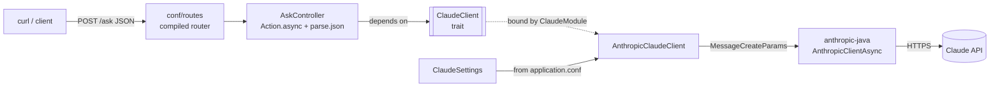

# Claude SDK for Scala · Play 3

**Calling Claude from Scala with the official Java SDK ([`anthropic-java`](https://github.com/anthropics/anthropic-sdk-java)), inside a Play Framework 3 app — fully async, Guice-wired, testable.**

There is no official Scala SDK for Claude. You don't need one: the Java SDK works great from Scala once you know the
handful of interop moves and one classpath trap. This repo is a small, readable reference for exactly that.

```bash
$ curl -s -X POST http://localhost:9000/ask -H 'Content-Type: application/json' \
       -d '{"prompt":"Explain a Scala Option in one sentence"}'

{"answer":"A Scala `Option` is a container type that holds either a value wrapped in `Some` or nothing at all
represented by `None`, letting you safely handle missing or nullable values without using `null`."}
```

| | |
|---|---|
| Framework | Play 3.0.12 (Pekko), sbt 1.12.15 |
| Language | Scala 2.13.18, JDK 25 |
| Claude | `com.anthropic:anthropic-java` 2.73.0, async OkHttp client |
| DI | Guice (runtime), `javax.inject` |
| JSON | play-json (`Json.reads` macro) |
| Tests | ScalaTest via `scalatestplus-play` |

---

## Quick start

You need JDK 25, sbt, and an [Anthropic API key](https://console.anthropic.com/).

**PowerShell**
```powershell
$env:ANTHROPIC_API_KEY='sk-ant-...'; sbt run
```

**bash / WSL**
```bash
ANTHROPIC_API_KEY='sk-ant-...' sbt run
```

Then call it:

```bash
curl -s -X POST http://localhost:9000/ask -H 'Content-Type: application/json' -d '{"prompt":"Hello Claude"}'
```

> If you already have an sbt shell open, exit it first — the env var must exist *before* sbt starts.

Run the tests (no API key needed):

```bash
sbt test
sbt "testOnly ai.ClaudeSettingsSpec"
```

---

## Architecture



```
app/
  ai/
    ClaudeClient.scala           trait — the only thing controllers know about
    AnthropicClaudeClient.scala  the real implementation, the only class that builds the SDK client
    ClaudeModule.scala           Guice: ClaudeClient -> AnthropicClaudeClient
    ClaudeSettings.scala         typed config (api key, model, max tokens)
  controllers/
    AskController.scala          POST /ask
conf/
  application.conf               ai.anthropic { ... }, JSON error handler, module registration
  routes
test/
  ai/ClaudeSettingsSpec.scala
  controllers/AskControllerSpec.scala   recording fake ClaudeClient: happy path + blank prompt never reaches Claude
```

**One rule drives the layout:** the SDK lives behind the `ClaudeClient` trait. The controller depends on the trait, so
tests can hand it an anonymous-class fake — no network, no tokens spent, no mocking library:

```scala
val fakeClaude = new ClaudeClient {
  override def ask(prompt: String): Future[String] = Future.successful(s"echo: $prompt")
}
val controller = new AskController(stubControllerComponents(), fakeClaude)(ExecutionContext.global)
```

---

## Using the Java SDK from Scala — what you actually need to know

### 1. The dependency: single `%`

```scala
libraryDependencies += "com.anthropic" % "anthropic-java" % "2.73.0"
```

`%%` appends your Scala binary version (`_2.13`) to the artifact name. `anthropic-java` is a Java/Kotlin artifact with
no Scala suffix, so it takes a single `%`.

### 2. The classpath trap: Jackson & Kotlin versions

The SDK is written in Kotlin and uses Jackson. Play *also* uses Jackson. sbt resolves conflicts by picking the highest
version **per artifact**, so after adding the SDK you end up with a mixed set:

```
jackson-databind           2.19.4   ← pulled up by the SDK
jackson-module-scala_2.13  2.14.3   ← still Play's version
jackson-dataformat-cbor    2.14.3
kotlin-stdlib 1.9.25  vs  kotlin-stdlib-jdk7/jdk8 1.9.10
```

It **compiles fine** — and fails later at runtime (`jackson-module-scala` refuses a databind outside its own minor
version, e.g. the first time Pekko's Jackson serialization is used). The fix is to pin one set with
`dependencyOverrides` (see [`build.sbt`](build.sbt)):

```scala
val jacksonVersion = "2.19.4"
val kotlinVersion  = "1.9.25"

dependencyOverrides ++= Seq(
  "com.fasterxml.jackson.core"   %  "jackson-databind"     % jacksonVersion,
  "com.fasterxml.jackson.module" %% "jackson-module-scala" % jacksonVersion, // the only Scala artifact → %%
  "com.fasterxml.jackson.module" %  "jackson-module-kotlin" % jacksonVersion,
  "org.jetbrains.kotlin"         %  "kotlin-stdlib"        % kotlinVersion,
  // ... every jackson-* and kotlin-* artifact, one version each
)
```

Check it yourself:

```powershell
$cp = sbt -batch "export Compile/dependencyClasspath" | Select-Object -Last 1; $cp -split ';' | Split-Path -Leaf | Where-Object { $_ -match 'jackson|kotlin' } | Sort-Object
```

### 3. Java ⇄ Scala interop cheat sheet

The SDK speaks Java. These four imports cover almost everything:

| SDK gives you | You want | How |
|---|---|---|
| `X.builder()...build()` | — | Just use the builders; there are no case classes |
| `CompletableFuture[T]` | `Future[T]` | `import scala.jdk.FutureConverters._` → `.asScala` |
| `java.util.Optional[T]` | `Option[T]` | `import scala.jdk.OptionConverters._` → `.toScala` |
| `java.util.List[T]` | Scala collection | `import scala.jdk.CollectionConverters._` → `.asScala` |
| `long` parameters | `Long` | e.g. `maxTokens(settings.maxTokens)` with `maxTokens: Long` |

Putting it together — the whole call, from [`AnthropicClaudeClient.scala`](app/ai/AnthropicClaudeClient.scala):

```scala
override def ask(prompt: String): Future[String] = {
  val params = MessageCreateParams.builder()
    .model(settings.model)
    .maxTokens(settings.maxTokens)
    .addUserMessage(prompt)
    .build()

  client.messages().create(params).asScala.map(textOf)   // CompletableFuture → Future
}

private def textOf(message: Message): String =
  message.content().asScala                 // java.util.List → Scala
    .flatMap(block => block.text().toScala) // keep only text blocks (Optional → Option)
    .map(_.text())
    .mkString
```

### 4. Async all the way down

Use `AnthropicClientAsync`, not the blocking client. Play actions can return `Future[Result]`
(`Action.async`), so no Play thread is parked while Claude is generating:

```
OkHttp thread completes CompletableFuture
  → .asScala → Future[Message] → .map(textOf) → Future[String] → .map(Ok(...)) → Play writes the response
```

### 5. One client, closed on shutdown

The SDK client owns connection pools and threads. Build it **once** (`@Singleton`) and close it with Play's lifecycle,
otherwise every dev-mode reload leaks threads:

```scala
lifecycle.addStopHook(() => Future(client.close()))
```

### 6. API key from config, not from the SDK's env lookup

```hocon
ai.anthropic {
  api-key    = ${?ANTHROPIC_API_KEY}   # `?` = optional: missing var ≠ broken config
  model      = "claude-haiku-5-5"
  max-tokens = 1024
}
```

`ClaudeSettings.fromConfig` turns that into a case class and fails fast with a clear `PlayException` when the key is
missing or blank. Going through Play config (instead of `AnthropicOkHttpClientAsync.fromEnv()`) keeps a single source
of truth for every setting.

---

## REST-style errors

Play's default error handler renders HTML. For an API, one line switches every unhandled error (bad JSON, unknown
route, uncaught exception) to JSON:

```hocon
play.http.errorHandler = "play.api.http.JsonHttpErrorHandler"
```

```bash
$ curl -s -X POST http://localhost:9000/ask -H 'Content-Type: application/json' -d '{"prompt": oops}'
{"error":{"requestId":1,"message":"Invalid Json: Unrecognized token 'oops' ..."}}
```

Errors from Claude itself are mapped in the controller to a `502 Bad Gateway` with a JSON body:

```scala
.recover { case e: AnthropicServiceException =>
  BadGateway(Json.obj("error" -> s"Claude API returned ${e.statusCode()}"))
}
```

| Status | Meaning |
|---|---|
| `200` | `{"answer": "..."}` |
| `400` | Malformed JSON body |
| `415` | Missing `Content-Type: application/json` |
| `502` | Claude API returned an error (e.g. `401` = bad key) |

---

## Roadmap

This repo is built step by step as a learning project. Next up:

- [x] `AskControllerSpec` with a fake `ClaudeClient`
- [x] `400` for a blank prompt, without calling Claude
- [ ] Hardening: request timeout, `maxRetries`, handling `stopReason` (`MAX_TOKENS`, `REFUSAL`)
- [ ] System prompt with prompt caching (`CacheControlEphemeral`)
- [ ] Streaming responses: `createStreaming` → Pekko Streams `Source` → chunked HTTP response
- [ ] Custom `HttpErrorHandler` with a uniform error shape
